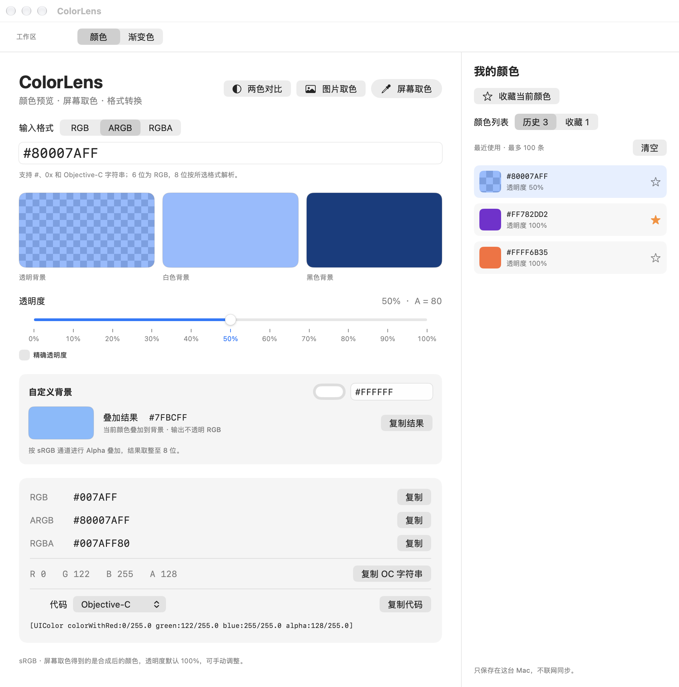
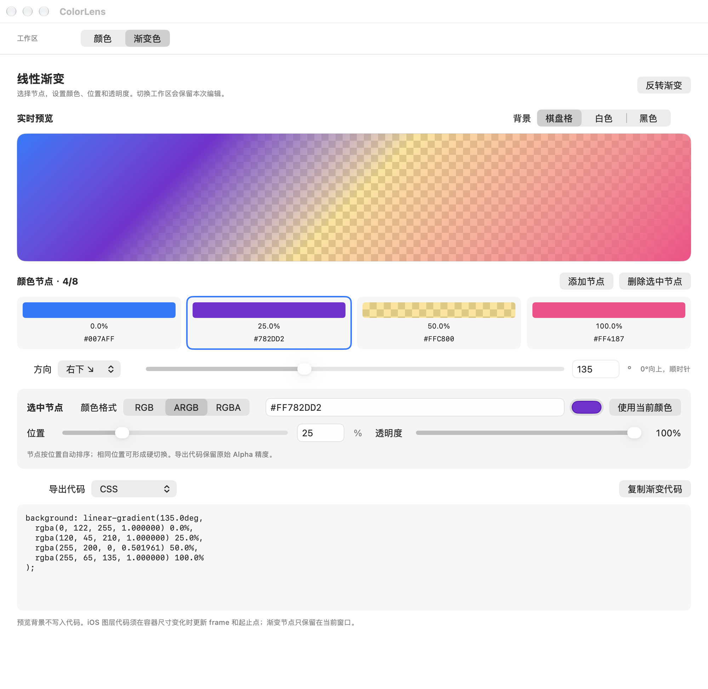
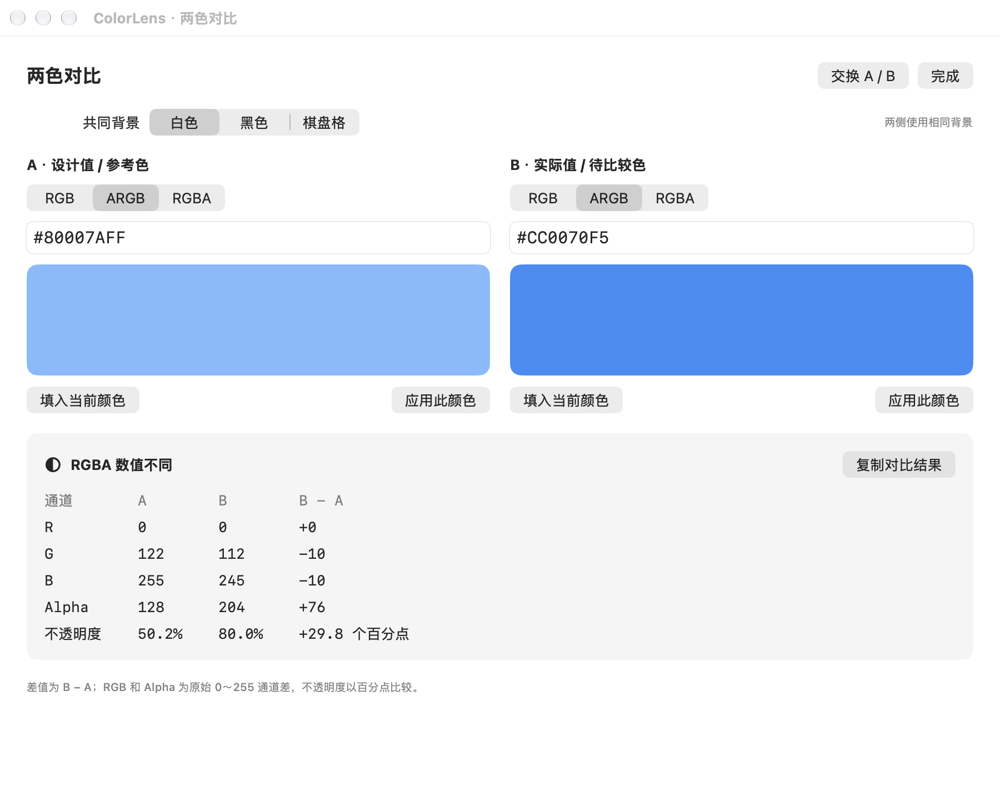
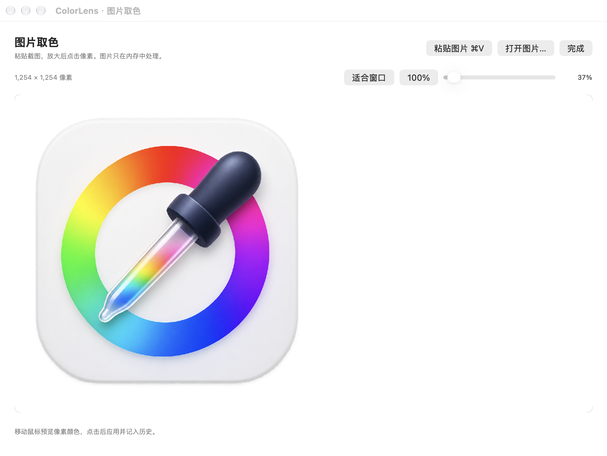

# ColorLens

一款原生 macOS 颜色与渐变工具：预览颜色字符串、屏幕和图片取色、比较设计值、查看透明叠加效果，并直接复制开发代码。

使用 SwiftUI 与 AppKit，无第三方依赖。颜色和图片在本机处理，不联网、不上传。

## 下载与安装

在 [GitHub Releases](https://github.com/jinying0218/ColorLens/releases/latest) 下载 `ColorLens-版本号-macOS-arm64.zip`，解压后将 `ColorLens.app` 拖入“应用程序”。

- 系统要求：macOS 13 或更新版本、Apple 芯片（M 系列）。目前未提供 Intel 安装包。
- 应用使用临时签名，尚未做 Developer ID 签名和 Apple 公证。如果提示开发者无法验证，请确认下载来源，再参照 [Apple 的说明](https://support.apple.com/102445)操作。
- README 展示当前源码的功能；下载包支持的功能以对应 Release 的说明为准。

## 功能概览

| 功能 | 能做什么 |
| --- | --- |
| 颜色字符串预览 | 支持 RGB、ARGB、RGBA，实时显示棋盘格、白底和黑底效果 |
| 透明度调整 | 默认按 1% 调整，每隔 10% 可点击跳转；精确模式保留 Alpha 0～255 |
| 屏幕取色 | 调用 Mac 系统取色器，统一输出 sRGB |
| 图片取色 | 粘贴或打开图片，缩放后点击物理像素取色，显示坐标并保留 Alpha |
| 历史与收藏 | 自动去重、点击恢复，保留最近 100 条；清空历史保留收藏 |
| 背景叠加 | 自定义不透明背景色，预览并复制透明颜色叠加后的最终 RGB |
| 两色对比 | 并排预览 A/B，比较 RGB、Alpha 和不透明度差，支持交换及复制报告 |
| 线性渐变 | 2～8 个颜色节点，设置位置、透明度、方向和角度，增删节点或反转渐变 |
| 复制代码 | 单色和渐变支持 Objective-C、Swift、SwiftUI、CSS；单色另支持 OC Hex 方法 |
| 可调整窗口 | 拖动窗口边缘改变尺寸；宽窗口可调整历史分栏，窄窗口自动改为上下布局 |

## 界面预览

以下图片来自实际运行的原生界面，使用独立的示例数据，不含个人图片、历史记录或桌面内容。

### 单色预览、透明度与历史收藏

输入颜色后查看不同背景效果，调整透明度，并复制颜色值或代码。右侧可恢复历史颜色和管理收藏。



### 线性渐变与代码导出

顶部切换到“渐变色”，编辑节点颜色、位置和透明度；支持方向预设、自定义角度、反转，以及黑白/棋盘格背景预览。



### 两色对比

分别选择 A/B 的输入格式，在相同背景下比较设计值和实际值。差值按 **B − A** 计算，不透明度差使用“百分点”。



### 图片像素取色

打开“图片取色”，按 `⌘V` 粘贴截图，或选择图片文件。放大后点击像素应用颜色；“适合窗口”会跟随当前可用区域调整比例。



## 使用说明

### 输入格式

- 6 位：`#007AFF`，表示 RGB，不含透明度。
- 8 位 ARGB：`#80007AFF`，前两位 `80` 为 Alpha。
- 8 位 RGBA：`#007AFF80`，后两位 `80` 为 Alpha。
- 支持 `#`、`0x`、普通引号和 Objective-C 字符串，例如 `@"#80007AFF"`。
- 8 位颜色无法自动判断字节顺序，需要明确选择 ARGB 或 RGBA。默认使用 ARGB。
- 非法输入会显示错误并禁用复制，预览暂时保留上一次有效颜色。

### 透明度与取色

- 默认滑杆按 0%～100% 整数调整；“精确透明度”按 Alpha 原始值 0～255 调整，并显示一位小数。
- 粘贴颜色中的原始 Alpha 会保留，切换精确模式不会改变当前颜色。
- 屏幕取色拿到的是最终合成颜色，无法恢复原始透明度，因此 Alpha 默认 `FF`。
- 图片取色使用物理像素坐标；缩放范围为 5%～800%。透明图片可保留原始 Alpha。
- 背景叠加按 sRGB 通道计算，结果取整至 8 位。复制的是最终不透明 RGB，不是原始 ARGB。

### 历史、窗口与渐变

- 输入或拖动停下 0.6 秒后记入历史；取色、复制立即记录。相同 RGBA 自动去重。
- 主窗口默认大小为 1000×820，最小为 680×480，不限制最大尺寸。小于 880 宽时，历史区移到内容下方。
- 宽窗口可拖动颜色区与历史区之间的分隔栏。图片取色和两色对比窗口也支持调整大小。
- 渐变角度采用 CSS 约定：0°向上、90°向右，顺时针旋转。预览与导出代码按实际画布宽高计算起止点。
- 渐变节点和角度保留在当前窗口，切换工作区不会丢失；关闭窗口后不保存。预览背景不会写入导出代码。
- iOS 渐变图层的容器尺寸改变后，需要同步更新 `frame` 和起止点。

## 从源码构建

需要 Swift 6 工具链，以及 macOS SDK（可安装带 Swift 6 的 Xcode）。在项目目录运行：

```sh
swift test
bash scripts/build-app.sh
```

将生成的 `dist/ColorLens.app` 拖入“应用程序”。也可以用 Xcode 打开 `Package.swift`。

### 更新 README 截图

下面的检查会使用独立示例数据，生成真实的原生窗口截图，并验证多个窗口尺寸。不会读取或修改个人历史、收藏、图片和剪贴板：

```sh
COLORLENS_DOCS_OUTPUT="$PWD/docs/screenshots" \
COLORLENS_DOCS_IMAGE="$PWD/Resources/AppIcon.png" \
swift test --filter captureDocumentationAndVerifyResizing
```

截图使用 macOS 自带的 `screencapture`。图片取色示例使用项目自身的应用图标。

## 隐私

- 没有网络请求、统计或自动剪贴板读取。
- 仅在点击复制时写入剪贴板，在图片窗口点击粘贴或按 `⌘V` 时读取图片。
- 历史、收藏和显示偏好保存在本机 UserDefaults，颜色记录仅含 RGBA 数值，不保存图片及图片路径。
- 图片只在内存中处理，不上传、不保存到历史。
- 构建产物、本机配置、会话记录和缓存不加入 Git；公开截图只包含示例数据。
